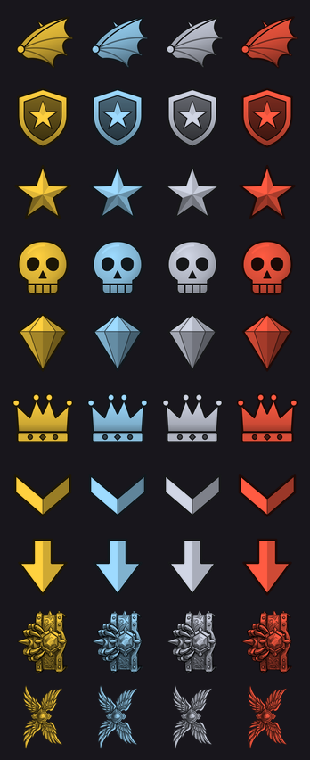

<p align="center"></p>

# Elite Mob Visuals

A lightweight World of Warcraft: **WoW Forever** addon that puts a clear,
customisable marker beside your target's nameplate when it is an **elite**,
**rare**, **rare elite** or **boss**, plus an optional marker above their heads.

It is for players whose nameplates (Blizzard's, Plater, ElvUI, EllesmereUI,
Kui or anything else) don't show elite and rare mobs the way they want. It
works alongside any nameplate addon, with no libraries and no dependencies.

## Features

- **Four visuals, each set up on its own.**

  | | Nameplate | Target frame |
  | --- | --- | --- |
  | **Badge** | Beside the nameplate | Beside your target's unit frame |
  | **Marker** | Above the nameplate (the mob's head), with an optional "Elite" / "Rare" label | Above your target's unit frame |

  The target frame can be EllesmereUI's, Blizzard's standard `TargetFrame`,
  ElvUI's or Shadowed Unit Frames', whichever is in use. With no target frame,
  or if you choose the free position, the target frame visuals sit wherever
  you drag them.
- **Visibility in one place.** The Visibility page has a box to tick for each
  visual:
  - **Nameplate badge and marker:** each with which nameplates it shows on
    (your target, every marked mob, or all but your target).
  - **Target frame badge and marker:** each always, or with *If the
    nameplate badge (marker) is off, use the target frame*, which is on by
    default. With that, the target frame steps in whenever its nameplate
    counterpart isn't showing on your target: it is turned off, nameplates
    are off, or the target is out of range.

  The filters (only mobs you can attack, only in combat, hide on dead mobs)
  are there too. Each visual's page only sets how it looks.
- **15 styles.** Eight bundled styles (Gilded Wing, Heraldic Crest, Faceted
  Star, Skull, Cut Gem, Crown, Chevron, Arrow), tinted to each classification's
  colour. Two end pieces, Clawed Clasp and Winged Gem, that wrap the end of
  the health bar (left, right or both); Size sets its height and Width stretches it to fit
  your plates. Five use the game's own art: the nameplate classification icon, the
  target-frame dragon, the classic vanilla dragon, the minimap rare vignette
  and the raid target icons.
- **Backgrounds.** Each visual can have a plain rectangle behind its art. You set
  its width, height, offset, colour and opacity, plus an optional border
  with its own colour and thickness. The border can take the classification
  colour instead.
- **Per-classification settings.** Each classification has its own on/off
  switch and colour. Each visual can give each classification its own style,
  a gold wing for elites and a star for rares, say. The target frame visuals
  follow their nameplate counterpart unless set.
- **Placement.** Size, any side or corner of the plate, offsets, a mirrored
  pair on both sides, flip, opacity, glow, and pulse, breathe, bob or spin
  animations.
- **Filters.** Only mobs you can attack, only in combat, and hidden on
  dead mobs.
- **Options window.** A sidebar lists General, Visibility, Nameplate (Badge,
  Marker), Target frame (Badge, Marker) and Classifications. The live preview,
  drawn with the same code as the real visuals, shows what the selected page
  edits. Visual pages show that visual alone, even while it's off;
  General, Visibility and Classifications show everything by the rules.
- **Test mode.** `/emv test` marks every nameplate, so you can position the
  visuals on real plates without hunting for an elite.
- **Minimap button.** Left-click opens the options, right-click hides the
  button, and you can drag it around the rim. Minimap button bags and drawers
  can collect it (it is a LibDBIcon look-alike named
  `LibDBIcon10_EliteMobVisuals`, parented to `Minimap`), and it is published
  to LibDataBroker for broker displays such as Titan Panel and ChocolateBar,
  without shipping either library.
- **Settings page.** The game's *Settings > AddOns > Elite Mob Visuals* page
  has the everyday switches and a button that opens the full options window.



*Bundled styles in the default Elite, Rare Elite, Rare and Boss colours.*

## Usage

| Command | Does |
| --- | --- |
| `/emv` | Open the options window (also the minimap button, and the minimap's addon list) |
| `/emv settings` | Open the page in the game's Settings, under AddOns |
| `/emv minimap` | Show or hide the minimap button |
| `/emv test [elite\|rareelite\|rare\|worldboss]` | Test mode: mark every non-player nameplate as that classification, and show the badge (and the marker, if on) on all of them whatever *Show on* says |
| `/emv debug` | Print what the addon sees on each nameplate: classification, filters, where the visuals attach and whether they are visible |
| `/emv on`, `/emv off`, `/emv toggle` | Turn the addon on or off |
| `/emv reset` | Every setting back to its default |

The options window is a small movable window rather than a page in the
full-screen Settings panel, so your nameplates stay in view while you
position the visuals.

## Development

The repo is the addon. A junction from the game's AddOns folder to the repo
lets you edit and `/reload`.

```powershell
./scripts/link/forever/link-addon.ps1        # AddOns\EliteMobVisuals -> this repo
./scripts/link/forever/unlink-addon.ps1      # remove that junction (files untouched)
```

### Tests

The tests run the addon's Lua in a Lua VM (fengari) against a small mock of the
WoW API (`tools/tests/lua/wow-mock.lua`).

```powershell
cd tools/tests
npm install      # once
npm test         # or: node run-all.js <name filter>
```

| File | Covers |
| --- | --- |
| `compile.test.js` | Every TOC file exists and compiles, and every texture it names ships |
| `smoke.test.js` | A whole session: plates, targeting, secret values, late unit data, every style, placement and animation, test mode, combat filter, the target frame badge (Blizzard's and EllesmereUI's frames, fallback and always modes, out of range, free position), EllesmereUI's own plates (attached late, lifted strata, anchors, hand-back on removal), the minimap button and its LibDataBroker launcher, the options window and Settings page, reset and saved-variable stripping |
| `minimap.test.js` | The minimap button sits where LibDBIcon-1.0 would put it, for every minimap shape (`golden/minimap-placement.json`, recorded from LibDBIcon in Epithet) |

### Building

```powershell
./scripts/build/build.ps1              # tests, then dist/EliteMobVisuals-<version>-forever.zip
./scripts/build/build.ps1 -Bump patch  # bump the version first (also minor, major)
./scripts/build/build.ps1 -SkipChecks  # build only
```

To test the packaged build in game, run
`./scripts/link/dist-forever/link-forever.ps1`, which points the AddOns
junction at `dist/forever/EliteMobVisuals`. Run `link-addon.ps1` to switch
back to the repo.

The package contains only `EliteMobVisuals.toc`, `LICENSE`, `NOTICE`, and the
`Core/`, `Locales/`, `UI/` and `media/` folders.
`.pkgmeta` leaves out the same development files if CurseForge packages from
the repo.

### Art

Every texture comes from an SVG in `tools/art/src/`. After editing one, run:

```powershell
pip install cairosvg pillow   # once
python tools/art/build-art.py
```

The script writes:

- `media/textures/*.tga`: the badge textures, 128×128 and greyscale so the
  addon can tint them.
- `media/logo/emv-logo-128.tga`: the full logo, with wings, for the options
  window and the Settings page.
- `media/logo/emv-icon-64.tga`: the compact icon, without wings, for the
  minimap button, the addon compartment and the addon list (TOC
  `IconTexture`). It is padded, with all its art inside the middle 75%,
  because minimap button bags crop and ring the edge of any icon they collect.
  EllesmereUI's minimap flyout stretches the icon to the button, crops 5% off
  each side and draws its own ring over the rim.
- `docs/logo/`: the README images.
- `docs/logo/curseforge/emv-curseforge-1024.png`: the CurseForge project
  avatar, with 512 and 400 copies. It is the logo on an opaque square
  backdrop (`tools/art/src/curseforge-bg.svg`), so it reads on CurseForge's
  light and dark themes. The art spans 90% of the width, centred, clear of the
  tile's rounded corners. Upload the 1024.

Commit its output. The addon only ever loads the TGA files.

For design reference, `docs/reference/blizzard/` can hold the game's standard
target-frame elite, rare and rare-elite dragons
(`UI-TargetingFrame-Elite`, `-Rare`, `-Rare-Elite` from
[Gethe/wow-ui-textures](https://github.com/Gethe/wow-ui-textures), folder
`TARGETINGFRAME`). They are Blizzard's art, so `.gitignore` keeps them out of
the repo and the build never packages them. The *Classic Dragon* style crops
the same files from the game client at runtime.

### Layout

```text
EliteMobVisuals.toc
Core/
  Init.lua             namespace, secret-value guard, settings-changed callbacks
  DB.lua               saved variables with defaults (no libraries)
  Defaults.lua         every option and its default
  Media.lua            the style registry; resolves a style and classification to a texture
  Classify.lua         which units are marked, and the unit filters
  Plates.lua           nameplate addon adapters: where the visuals attach (EllesmereUI, ...)
  Visuals.lua          a badge, its pair and a marker on one plate or frame
  TargetFrame.lua      the badge and marker on the target unit frame (EllesmereUI, Blizzard, ...)
  MinimapButton.lua    the minimap launcher, a LibDBIcon look-alike (from Epithet)
  EliteMobVisuals.lua  events, nameplate tracking, slash commands
Locales/enUS.lua       strings (keys are the English text)
UI/Widgets.lua         flat option controls, no Blizzard templates
UI/Options.lua         the options window (sidebar, pages, live preview) and the game Settings page
media/                 shipped TGA textures and logo
tools/art/             SVG sources and the render script (dev only)
tools/tests/           fengari tests (dev only)
scripts/               build and junction scripts (dev only)
docs/                  logo renders and CurseForge images (dev only)
```

## WoW Forever notes

These were checked against the local client (`_forever_`, 1.60.1.70938) and the
Forever addons installed there.

- **Interface `16001`.** The source TOC lists only Forever. To ship on Retail
  too, add `120105` to the TOC and a target in `build.ps1`.
- **12.x engine rules apply.** Forever runs on the Midnight engine with vanilla
  content, so some unit reads can return *secret values*, and comparing one
  raises an error. Every unit read goes through `ns.Readable`, which turns a
  secret into nil, so the check fails closed instead of erroring.
- **Classification can arrive late.** A mob seen for the first time can read
  `"normal"` until its data loads. The addon re-checks on `UNIT_NAME_UPDATE`
  and `UNIT_CLASSIFICATION_CHANGED`.
- **Blizzard art used by the native styles** (Forever addons on the client
  use them too): `nameplates-icon-elite-gold`, `nameplates-icon-elite-silver`,
  `nameplates-icon-rareelite`, `UI-HUD-UnitFrame-Target-PortraitOn-Boss-Gold`,
  `...-Boss-Gold-Winged` and `...-Boss-Rare-Silver-Winged`. Each atlas is
  looked up before use, with fallbacks, so missing art falls back to a bundled
  style instead of a blank square.
- **Nameplates.** Each plate comes from `C_NamePlate.GetNamePlateForUnit`.
  Forbidden plates (friendly plates in instances) return nil and are skipped.
  By default the badge sits beside the health bar and the marker above the
  name. Blizzard, Plater, ElvUI and KuiNameplates bars are found inside the
  nameplate frame. Any other nameplate addon falls back to the frame itself.

## Nameplate addons

`Core/Plates.lua` holds an adapter for each nameplate addon that needs one.

**EllesmereUI Nameplates** draws its own plate rather than restyling
Blizzard's, which used to break the visuals in four ways:

| EllesmereUI does | Effect on the visuals before the adapter |
| --- | --- |
| Sizes Blizzard's nameplate frame to its health bar (`C_NamePlate.SetNamePlateSize`) | That frame's top is the bar's top, where EllesmereUI draws the name, so the overhead marker sat on the name |
| Lifts its text (level 900), auras (800) and indicators to `MEDIUM` strata, on a plate that flattens its render layers | The visuals, left at the nameplate's own strata, drew under all of them |
| Scales its own plate (Target Scale, cast scale, minor enemies) and shifts it by its Y offset | The badge stayed on the unscaled Blizzard frame and drifted on or off the bar |
| Fades its plates (non-target and out-of-combat opacity) | The visuals did not fade with the plate |

The adapter finds EllesmereUI's plate through the namespace it exposes
(`EllesmereNameplates_NS.plates[unit]`). It then:

- parents the visuals to that plate, so they scale and fade with it;
- anchors the badge to its health bar and the marker above its name (or above
  the bar, when the name has been moved into the bar);
- draws them at `MEDIUM` strata, level 850: over its auras, under its text.

EllesmereUI attaches its plate in its own `NAME_PLATE_UNIT_ADDED` handler,
which can run after ours, so each new plate is checked again on the next
frame. When a plate goes away, the visuals return to the Blizzard nameplate,
so EllesmereUI's pooled plates never carry them to another mob.

EllesmereUI has its own Rare/Elite indicator (Nameplates > Display Layout).
It uses the same four Blizzard icons as the *Blizzard Nameplate Icon* style,
in its own slot and at its own size, so these options can't move it. With
*Hide EllesmereUI's own Rare/Elite icon* (General tab, on by default) the
addon fades it out on every mob it marks, and gives it back as soon as the
mob is no longer marked. EllesmereUI only ever shows and hides that frame,
never fades it, so the two don't fight. On a marked mob it also carries
EllesmereUI's quest icon.

## Target frames

`Core/TargetFrame.lua` puts the badge on the first target frame in use, from
`TargetFrame.CANDIDATES`:

| Frame | Comes from |
| --- | --- |
| `EllesmereUIUnitFrames_Target` | EllesmereUI Unit Frames, when its target frame source is EllesmereUI (it spawns no frame of its own when set to Blizzard's or hidden) |
| `ElvUF_Target` | ElvUI |
| `SUFUnittarget` | Shadowed Unit Frames |
| `TargetFrame` | Blizzard's standard frame |

A frame is in use when its parent is shown and not faded out. EllesmereUI
parks Blizzard's `TargetFrame` on a hidden parent, so that frame never wins
there. Secure unit frames show themselves a moment after the target changes,
so the badge is checked again on the next frame and after 0.3 seconds. The
badge is anchored to the unit frame, never parented to it (unit frames are
secure), and follows the frame's scale.

## Licence

Apache 2.0. See [LICENSE](LICENSE) and [NOTICE](NOTICE).
