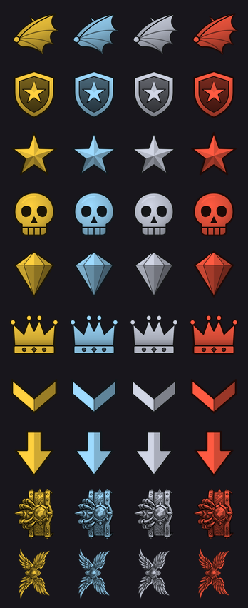

# Elite Mob Visuals

Clear, customisable markers for **elite**, **rare elite**, **rare** and **boss** mobs in **WoW Forever**, for when your nameplates don't show them the way you want.

---

## What it does

**Nameplate badge**: a badge beside the nameplate of your target, or of every marked mob.

**Nameplate marker**: a marker above marked mobs' heads, with an optional Elite / Rare label.

**Target frame badge and marker**: the same on your target frame, always or only when the nameplate can't show them (nameplates off or out of range).

---

## Make it yours

**15 styles**: eight original designs, two end pieces (a clawed clasp and a winged gem) that wrap the end of the health bar, and the game's own elite, rare and dragon art.

**A colour and style per classification**: a gold wing for elites and a silver star for rares, for example.

**Placement and effects**: size and width, position, offsets, opacity, glow, a background with a border, and pulse, breathe, bob or spin animations.

**Filters**: only mobs you can attack, only in combat, hide on dead mobs.

**Live preview and test mode**: see changes as you make them, and mark every nameplate to set things up anywhere.

---

## Works with

**Nameplates**: Blizzard, EllesmereUI, Plater, ElvUI and KuiNameplates. With EllesmereUI it scales and fades with its plates, and can hide EllesmereUI's own rare/elite icon so you don't see two.

**Target frames**: Blizzard, EllesmereUI, ElvUI and Shadowed Unit Frames.

Lightweight, with no libraries. It has a minimap button that minimap button bags can collect, and a page in the game's Settings.

---

## Commands

| Command | Does |
| --- | --- |
| `/emv` | Open the options |
| `/emv test` | Mark every nameplate, to set things up (`/emv test rare` for a chosen type) |
| `/emv on` / `/emv off` | Turn it on or off |
| `/emv minimap` | Show or hide the minimap button |
| `/emv debug` | Show what the addon sees, for bug reports |
